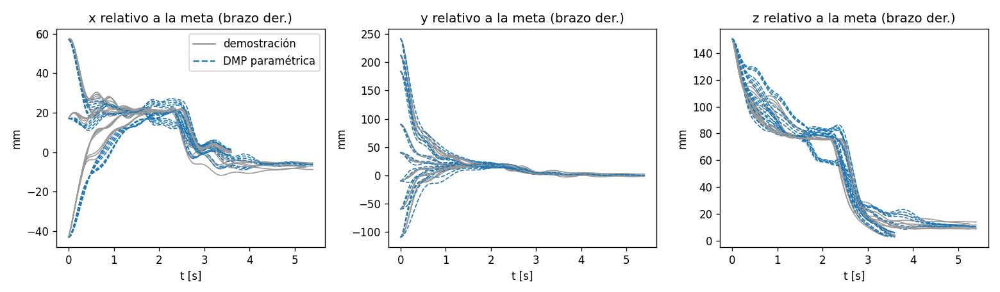

# LfD, fase A: DMP de alcance sobre la faja

> Las citas [n] remiten a [REFERENCIAS_VISUAL_SERVOING.md](REFERENCIAS_VISUAL_SERVOING.md).

Este documento cubre la **primitiva de bajo nivel** del aprendizaje por
demostración de la tesis. Es una DMP que reemplaza la generación de
trayectorias a mano (APPROACH → DESCEND de `GraspServoing`) en el picking de
la fruta sobre la faja. El nivel alto (la biblioteca de habilidades más
behavior cloning) es la fase B.

| Archivo | Qué contiene |
|---|---|
| `aprendizaje/dmp.py` | `DMP` (ajuste agrupado o paramétrico, reproducción, guardar/cargar) y `DMPRunner` (integración en línea, freno de fase) |
| `aprendizaje/demostraciones.py` | traza del lazo cerrado → demostración relativa a la meta (convención del brazo derecho) |
| `vision/visual_servoing.py` | `GraspServoing(reach_dmp=...)`: fase `REACH` |
| `demos/dmp_alcance.py` | `generar` / `entrenar` / `evaluar` |
| `demos/visual_servoing_grasp.py` | `run_trial(..., fruit_x, reach, reach_tau)` y las métricas de suavidad y agarre real |
| `test/test_dmp.py` | tests sin MuJoCo |
| `results/dmp/` | demos, modelos `.npz`, `entrenamiento.csv`, `evaluacion.csv`, figuras |

---

## 1. Dónde entra la DMP

```text
cámara -> esfera -> Kalman (p, v) --> g(t) = agarre de muñeca sobre la fruta predicha
                                        |
                       DMP (y = x - g) -+-> x_ref = g + y,  ẋ_ref = ġ + ẏ
                                        |
                  QP bimanual (ẋ = ẋ_ref + Kp (x_ref - x), dampers) -> q
```

La división de roles es la de Pastor *et al.* [32]:

- la **DMP** pone la *forma* y el *tiempo* del movimiento;
- la **percepción** pone la meta g;
- el **QP** pone la seguridad (límites, choques brazo-brazo y con el
  entorno) [35].

La orientación de la muñeca y el punto de agarre siguen saliendo de
`grasp_geometry`. La mano humana y la Inspire no agarran igual
(VISUAL_SERVOING_PLAN §7, brecha 1).

La máquina de estados queda como **supervisor**: elige el brazo (WAIT), aborta
(MISSED) y, después del alcance, cierra, levanta, retira y verifica.

## 2. Formulación

### 2.1 Relativa a la meta (meta móvil)

La DMP no aprende posiciones absolutas, sino la posición de la muñeca **vista
desde la meta**, y = x − g. En ejecución:

    x_ref(t) = g(t) + y(t)          ẋ_ref(t) = ġ(t) + ẏ(t)

- Con la fruta quieta, ġ = 0.
- Sobre la faja, ġ es la velocidad que estima el Kalman.

La forma del acercamiento (pasar por encima y bajar por la normal de la palma)
se conserva aunque la fruta avance. Es la idea de las DMP para metas móviles
[34], escrita en el frame de la meta. Además, cada corrección de la percepción
re-parametriza g en cada ciclo sin reiniciar la primitiva.

### 2.2 Sistema de transformación (Pastor 2009 [32])

Por eje, con la meta del sistema relativo en 0 y K = α²/4, D = α (crítico, α = 25):

    τ ż = K (0 − y) − D z − K (0 − y0) s + K f(s)
    τ ẏ = z

f está en metros y **no se escala por (g − y0)**, a diferencia del escalado
clásico de Ijspeert [31]. Con el escalado clásico, un eje cuyo desplazamiento
demostrado es casi nulo o cambia de signo entre demos (aquí, y) amplifica o
invierte la forma.

### 2.3 Fase lineal y freno de fase

s = 1 − t/τ, y f(s) = s · Σψᵢwᵢ / Σψᵢ con 20 gaussianas uniformes en s.

- Con la fase exponencial, la última parte del movimiento llega tarde. Es una
  lección de la DMP del UR5 en el proyecto cafetero.
- Pasado τ, s = 0 y queda solo el atractor hacia g.
- Opcional (`reach_alpha_err`): la fase se frena con el error de seguimiento,
  ṡ ∝ 1/(1 + α_e‖x_ref − x‖) [31]. Así la referencia no se escapa cuando un
  damper del QP frena el brazo.

### 2.4 Agrupada vs. paramétrica

Las demos empiezan en puntos muy distintos respecto de la fruta: y0 va de
−0.11 a +0.24 m según dónde esté la fruta.

- **Agrupada:** un solo w ajustado a todas las demos.
- **Paramétrica:** w(θ) = W0 + W1·θ, con θ = y0 normalizado. Los ejes con un
  y0 casi constante no se normalizan. Sigue siendo mínimos cuadrados lineal
  (Matsubara *et al.*, Neural Netw. 2011).

Resultado de entrenamiento (LOO = validación dejando cada demo fuera):

| Modelo | Error de ajuste | Error LOO medio | Error LOO máximo |
|---|---|---|---|
| Agrupada | 64.1 mm | 67.5 mm | 120.2 mm |
| **Paramétrica** | **6.9 mm** | **7.7 mm** | **11.7 mm** |

La agrupada promedia formas incompatibles. Por eso la paramétrica es la que
se usa: `results/dmp/dmp_alcance.npz`.



## 3. Demostraciones (por ahora, sintéticas)

`dmp_alcance.py generar` corre la máquina de estados con verdad de terreno
(un oráculo) en un conjunto de entrenamiento:

- fruta quieta en x ∈ {0.30, 0.34, 0.40} × y ∈ {−0.25, −0.15, −0.05, 0.10, 0.20};
- faja en x ∈ {0.30, 0.40} × v ∈ {0.03, 0.05, 0.07} m/s.

De esos 21 ensayos agarran 20. Falla x = 0.40, y = −0.25, que queda fuera del
alcance. Cada demo es el tramo APPROACH…CLOSE del brazo que agarra:

- se refleja en y si es el brazo izquierdo;
- se suaviza con Savitzky-Golay, porque la máquina de estados cambia la meta de
  golpe;
- se interpola a 100 Hz.

El alcance demostrado dura 4.17 ± 0.85 s.

**Ojo:** la demo hereda los defectos de la máquina de estados, en particular
la **pausa en el pre-agarre** (z ≈ 80 mm entre ~1 y 2.3 s, mientras espera la
tolerancia de 15 mm y los 0.5 s mínimos). La DMP la aprende. Con τ menor que
la duración demostrada esa pausa se comprime.

Estas demos sirven para montar y validar el pipeline. Las humanas (fase C,
Multiview_Demo_Capture) entran por la misma interfaz: (t, y relativa a la
meta).

## 4. Evaluación en lazo cerrado

`dmp_alcance.py evaluar` usa la misma física, percepción **real** (ajuste de
esfera con ruido D435), el Kalman y el QP con dampers que el resto del plan.
Las posiciones y velocidades **no están en el entrenamiento**:

- fruta quieta en x ∈ {0.32, 0.37} × y ∈ {−0.20, −0.10, 0.0, 0.15, 0.25};
- faja en x ∈ {0.32, 0.37} × v ∈ {0.04, 0.06, 0.08} m/s.

Métricas:

- **real:** la fruta terminó levantada más de 8 cm (verdad de terreno);
- **verif:** además lo confirmó la cámara (§4.2);
- **t alcance:** del inicio al cierre;
- **t ciclo:** del inicio al agarre verificado;
- **err cierre:** del punto de agarre a la fruta real;
- **jerk RMS** de la muñeca durante el alcance;
- **camino:** longitud de la trayectoria de la muñeca;
- **d brazos:** distancia mínima entre brazos.

### 4.1 Resultados (192 ensayos: 16 casos × 3 semillas × 4 configuraciones)

| Configuración | Real | Verif | t alcance | t ciclo | Err cierre | Jerk | Camino | d brazos |
|---|---|---|---|---|---|---|---|---|
| Máquina de estados | 41/48 | 35/48 | 3.75 s | 7.77 s | 12.9 mm | 10.0 | 0.27 m | 271 mm |
| DMP, τ = 1.0·τ_demo | 43/48 | 33/48 | 4.48 s | 8.78 s | 14.3 mm | 9.3 | 0.36 m | 255 mm |
| **DMP, τ = 0.7·τ_demo** | **43/48** | **37/48** | **3.30 s** | **7.13 s** | 14.8 mm | 18.2 | 0.38 m | 276 mm |
| DMP, τ = 0.5·τ_demo | 42/48 | 35/48 | 3.04 s | 6.76 s | 15.4 mm | 24.3 | 0.37 m | 278 mm |

Solo con la faja en movimiento (18 ensayos por configuración):

| Configuración | Real | t ciclo |
|---|---|---|
| Máquina de estados | 16/18 | 7.40 s |
| DMP τ×1.0 | 18/18 | 8.70 s |
| DMP τ×0.7 | 18/18 | 7.09 s |
| DMP τ×0.5 | 15/18 | 6.03 s |

Lectura:

1. **La DMP generaliza a posiciones y velocidades no demostradas** con el
   mismo éxito real que la máquina de estados que la generó: 43 frente a 41 de
   48. La diferencia está dentro del ruido.
2. **El tiempo es el parámetro que se gana gratis.** Con τ = 0.7 el alcance es
   un 12% más corto y el ciclo un 8% más corto, sin perder éxito. Con τ = 0.5
   el ciclo baja un 13%, pero empiezan a fallar casos con la faja a 0.08 m/s.
   τ = 0.7 es el valor por omisión del nodo.
   - Es la palanca que necesita la ventana temporal de la faja: a 0.07 m/s la
     ventana de un brazo es de ~5.4 s.
3. **El costo es suavidad y camino.** El jerk sube de 10 a 18 m/s³ y el camino
   de 0.27 a 0.38 m.
   - La DMP reproduce la *forma* de la máquina de estados, incluida la pausa
     del pre-agarre. Comprimida en el tiempo, esa pausa se convierte en un
     frenazo.
   - Con la faja en marcha, el camino absoluto es mayor porque la referencia
     g + y arrastra toda la forma con la fruta.
   - Las demos humanas, sin la pausa artificial, deberían corregir las dos
     cosas.
4. **Las fallas comunes a todas las configuraciones son de percepción, no del
   alcance.**
   - Ocurren con la fruta lejos o hacia afuera (x = 0.37, y = 0.15–0.25): el
     punto de agarre queda a 17–30 mm de la fruta real, por encima de la
     tolerancia física de la mano.
   - El error del ajuste de esfera crece con la distancia y con la oclusión
     de la mano.
5. Al operar con dos brazos, la distancia mínima entre ellos no cambia (el
   QP sigue mandando).

### 4.2 Falso negativo del verificador, y su corrección

En §4.1, "verif" es menor que "real" en todas las configuraciones: 35 de 41
con la máquina de estados, y 10 de 18 con la DMP τ×1.0 en la faja, aunque
las 18 frutas se levantaron.

**Causa (medida):** en la pose de retiro (`home`) la fruta cae en el píxel
(454, 325), lejos del borde, pero **los dedos cerrados la tapan**: desde la
cámara de la cabeza se ve el 3–13% del área esperada. Por debajo del 35% no
hay medida, y a los 5 s el verificador declara FAILED con la fruta en la
mano. Primero lo atribuí al borde de la imagen por un recuadro del video;
la medida directa lo descartó.

**Corrección:** una pose de **mostrar** durante el retiro
(`GG.show_wrist_target`), con la palma **arriba**: el agarre girado 180°
sobre el eje de los dedos y la fruta en (0.36, ±0.18, 0.10), fuera de la
faja. Barrido (posición × elevación × giro × desplazamiento de la fruta en
la mano):

| Giro sobre los dedos | Fruta visible | Error de la esfera |
|---|---|---|
| 0° (como el agarre) | 0% | sin medida |
| ±45° | 0–60%, según dónde quedó la fruta | inestable |
| **180° (palma arriba)** | **55–64%**, aunque la fruta quede ±3 cm corrida | **1.3–1.5 mm** |

Con la palma arriba, en el robot real la fruta además descansa en la
palma. Resultado: 144 ensayos con las mismas semillas.

| Configuración | Real | Verif (antes → ahora) | t ciclo (antes → ahora) |
|---|---|---|---|
| Máquina de estados | 40/48 | 35 → **40** | 7.77 → 6.79 s |
| DMP τ×0.7 | 43/48 | 37 → **43** | 7.13 → **6.27 s** |
| DMP τ×0.5 | 42/48 | 35 → **42** | 6.76 → 5.99 s |

Ahora verif = real, y el ciclo es ~1 s más corto porque la cámara confirma
antes. Las fallas que quedan son agarres que de verdad no ocurrieron.

### 4.3 En vivo (ROS)

`ros2 launch h1_2_algoritms visual_servoing_sim.launch.py belt:=moving reach:=dmp`
(2026-10-22), con τ = 2.92 s:

    WAIT -> REACH: brazo right, fruta en y=-0.375 m
    REACH -> CLOSE (3.1 s desde el inicio, punto de agarre a 8 mm)
    RETREAT -> DONE: agarre verificado, ciclo 5.7 s

### 4.4 Meta móvil vs. meta predictiva (intercepción): resultado negativo

En los episodios de varias frutas (fase B, docs/LFD_BC.md), el planificador
llegaba a empezar un alcance con la fruta todavía fuera del alcance del brazo.
Con la meta móvil, la DMP persigue la fruta hasta los límites articulares
(abortos con la mano a 260–290 mm). Se probó la meta PREDICTIVA del
manuscrito, g = p(t_agarre) (opción `reach_intercept`), con una DMP entrenada
solo con demos de fruta quieta (LOO 7.2 mm) y con igualación de velocidad
al final. Solo con la faja en movimiento, 18 ensayos por celda:

| DMP | Meta | Agarres | Err cierre |
|---|---|---|---|
| original (todas las demos) | **móvil** | **18/18** | 17.8 mm |
| solo fruta quieta | móvil | 16/18 | 14.5 mm |
| solo fruta quieta | intercepción + igualación de velocidad | 10/18 | 20.6 mm |
| original | intercepción | 8/18 | 18.8 mm |

Con la intercepción, la mano espera en el punto de cita y la fruta **entra
de lado** mientras la mano baja: el punto de agarre pasa de 108 mm adelante
de la fruta a 12 mm atrás. Igualar la velocidad en el último 60% del
alcance no lo arregla. La meta móvil baja *acompañando* a la fruta, sin
movimiento relativo lateral, y es la que queda por omisión.

El problema original se resolvió donde corresponde, en el planificador:
la fruta debe estar a menos de 8 cm de la ventana del brazo al empezar
(`alto_nivel.start_interval`, `track_band`).

## 5. Uso

```bash
source ~/venvs/h12/bin/activate && source /opt/ros/humble/setup.bash && source ~/humanoid_ws/install/setup.bash
cd ~/humanoid_ws/src/h1_2_algoritms
MUJOCO_GL=egl python3 demos/dmp_alcance.py generar     # ~1.5 min (21 demos)
python3 demos/dmp_alcance.py entrenar                  # segundos
MUJOCO_GL=egl python3 demos/dmp_alcance.py evaluar --seeds 3
python3 demos/dmp_alcance.py resumen                   # vuelve a imprimir la tabla

# Un ensayo con video
MUJOCO_GL=egl python3 -c "import sys; sys.path.insert(0,'demos'); import visual_servoing_grasp as V; \
from h1_2_algoritms.aprendizaje.dmp import DMP; m=DMP.load('results/dmp/dmp_alcance.npz'); \
print(V.run_trial('moving','sphere',0.05, reach=m, reach_tau=0.7*m.tau_demo, video='/tmp/dmp.mp4'))"

# En vivo (ROS): después de entrenar, colcon build (instala el .npz en share/)
ros2 launch h1_2_algoritms visual_servoing_sim.launch.py belt:=moving reach:=dmp reach_tau_scale:=0.7
```

## 6. Pendiente

- **Demos humanas** (fase C): reemplazar las sintéticas. La interfaz (t, y)
  ya está. Faltan T_torso←W, la detección izquierda/derecha y el estado de
  agarre (VISUAL_SERVOING_PLAN §7, brechas 2 y 3).
- **Orientación en la DMP**: hoy la pone `grasp_geometry` desde el inicio.
  Si la DMP también la aprende, falta el feedforward angular en el QP.
- **τ adaptativo a la ventana**: elegir τ en línea según el tiempo que le
  queda a la fruta en la ventana del brazo [34]. Hoy τ es fijo.
- **Retiro con DMP**: LIFT y RETREAT siguen escritos a mano. Es la segunda
  habilidad de la biblioteca de la fase B.
- **Fase B**: biblioteca de habilidades (una DMP por habilidad, con
  precondiciones) y una política de alto nivel aprendida por behavior
  cloning (qué fruta, qué brazo, qué habilidad), con la regla FIFO como línea
  base.
